<div align="center">



<br/>

<a href="https://www.linkedin.com/in/bcandogan/"></a>
<a href="https://github.com/cvndogvn"></a>

<sub><code>can@korkut:~$</code> &nbsp; <a href="#-whoami">whoami</a> · <a href="#-stack">stack/</a> · <a href="#-projects">projects/</a></sub>

</div>

---

## `>_` whoami

<table>
<tr>
<td width="58%" valign="top">

```yaml
name:      Can Doğan
location:  Türkiye 🇹🇷
company:   Korkut Teknoloji
school:    Fatih Sultan Mehmet Vakıf Üniversitesi
role:      Red Team Operator
past:      Penetration Tester
focus:
  - red team operations & adversary emulation
  - active directory attacks & lateral movement
  - web / api penetration testing
  - initial access & post-exploitation
status:    "learning > breaking > fixing > repeat"
```

</td>
<td width="42%" valign="top" align="center">



</td>
</tr>
</table>

---

## `>_` stack

<div align="center">

**`// web & backend`**
<br/>


<br/>


**`// systems & infra`**
<br/>


**`// red team & offensive security`**
<br/>


<br/>


<br/>


**`// arsenal`**
<br/>


<br/>


</div>

---

## `>_` projects

<table>
<tr>
<td>

### 🛡️ Hack Workshop &nbsp;<sub><code>2024 · bitirme projesi</code></sub>

Bölümün birinci sınıf öğrencilerini **test etmek ve eğitmek** için kurduğumuz,
5 farklı saldırıyı güvenli bir ortamda deneyimleten bir siber güvenlik laboratuvarı.

| saldırı | ne öğretiyor |
|:--|:--|
| `phishing` | sosyal mühendislik farkındalığı |
| `brute-force` | zayıf parola & rate-limit eksikliği |
| `sqli` | girdi doğrulama & parametreli sorgular |
| `privesc` | linux yetki yükseltme vektörleri |
| `ddos` | trafik koruma & cloudflare katmanı |


</td>
</tr>
</table>

---

<div align="center">
<sub><code>[ OK ] session closed · stay curious, stay ethical</code></sub>
</div>
